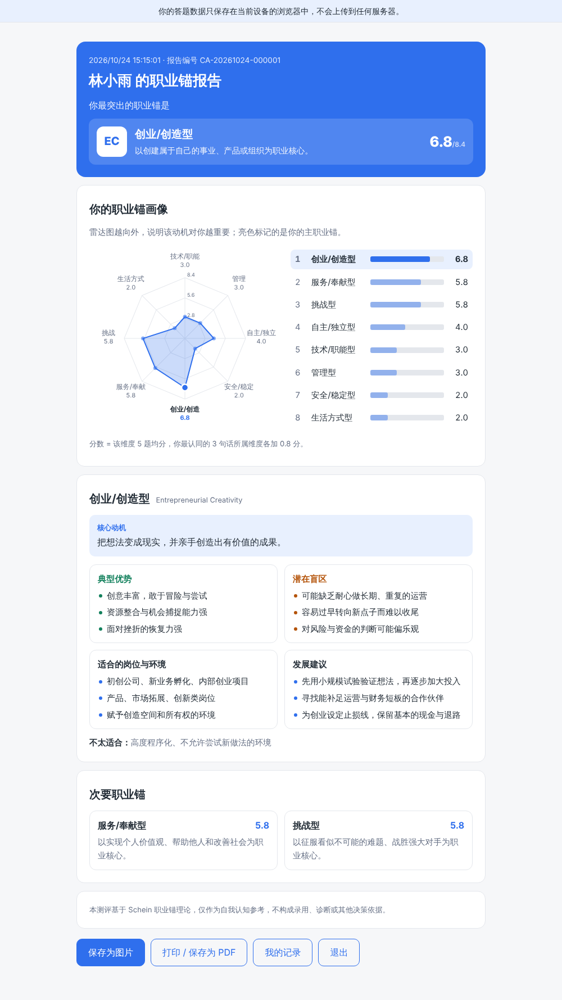
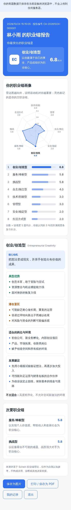
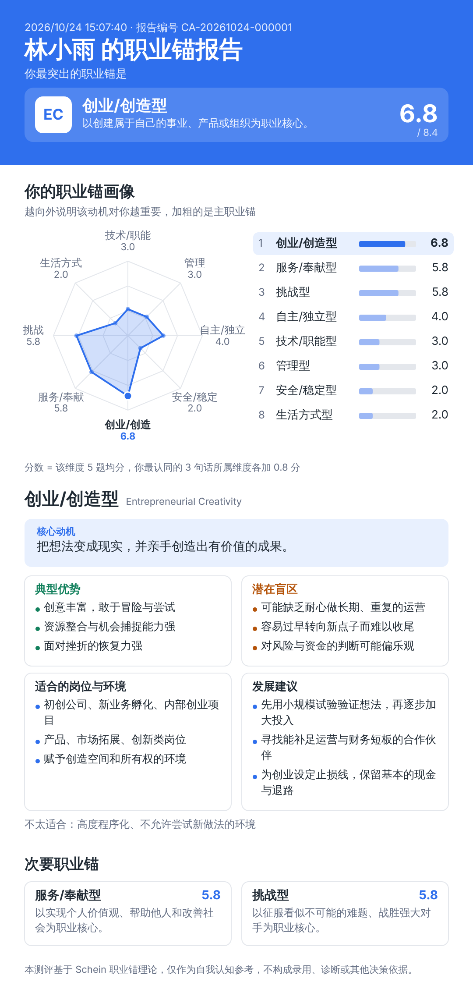
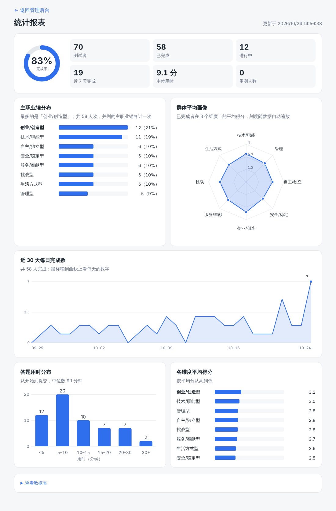
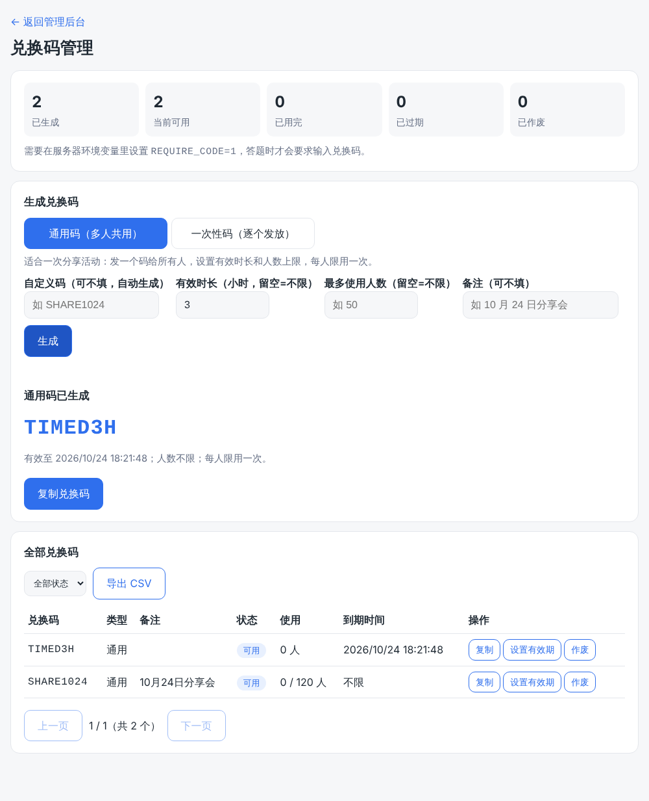

# 职业锚测试项目记录

> 最后更新：2026-10-24。这份文件记录从零做到上线的全过程、现状、关键决策和后续待办，下次继续时先读它。
>
> **产品管理体系见 [docs/product/README.md](product/README.md)**（战略、指标、路线图、优先级、流程、风险、模板、决策记录）；待办在 GitHub Issues，变更记录在根目录 `CHANGELOG.md`。
>
> 在新的 Claude 会话里继续时，可以直接说：「先读仓库 `docs/PROJECT-NOTES.md`，然后继续做 ……」。

## 1. 现状一览

| 项目 | 地址 | 说明 |
|---|---|---|
| 首页 | `https://matchgamers.com/` | GitHub Pages，职业锚测试介绍页，按钮指向完整版 |
| 职业锚测试（完整版） | `https://anchor.matchgamers.com/` | Render 上的 Node 服务，结果保存在服务器，**主推这个** |
| 职业锚测试（静态备用版） | `https://matchgamers.com/career-anchor/` | 纯前端，数据只在答题者浏览器里，首页不链接，**不用来卖** |
| 管理后台 | `https://anchor.matchgamers.com/admin.html` | 需管理员口令 |
| 统计报表 | `/report.html` | 只能从后台点链接进入 |
| 兑换码管理 | `/codes.html` | 只能从后台点链接进入 |
| 团队管理 | `/teams.html` | 只能从后台点链接进入；创建团队、团队码、团队报告码 |
| 团队负责人报告 | `/team.html` | 负责人凭「团队报告码」查看本团队汇总，不需要管理员口令 |
| 代码仓库 | `https://github.com/danieljun2025/XXL` | 主分支 `main` |

二维码（指向完整版）：

**兑换码功能已开发完成并上线，但没有启用。** 启用方法见第 6 节。

## 2. 做了什么（时间顺序）

1. **设计 Prompt**：先写设计文档 `docs/career-anchor-prompt.md`（早期版本，细节已与现状不同，只作历史参考）。
2. **开发完整版**：Node + SQLite 服务，40 题、8 个职业锚、报告、后台、导出 CSV、自动测试。
3. **去掉邮件**：邮箱 + 自设「查看密钥」代替邮件验证；忘记密钥由管理员重置。
4. **静态版**：为了能放 GitHub Pages，做了纯前端版（只填名字，不用后端），并加了「保存为图片」。
5. **站点整合**：首页一度做成项目清单，消消乐移到 `/game/xxl/`；之后决定只保留职业锚测试，**消消乐已整体移除**（可从提交 824a4a4 之前的历史找回），首页改为介绍页。
6. **域名与证书**：域名在 Cloudflare，4 条 A 记录 + `www` CNAME 指向 GitHub Pages（全部 DNS only）；GitHub Pages 自动签发 HTTPS 证书。
7. **部署完整版到 Render**：用仓库里的 `render.yaml` + `Dockerfile`，Starter 档 + 1GB 磁盘；子域名 `anchor.matchgamers.com` 用 CNAME 指向 Render（DNS only）。
8. **每页题数**：先是每页 10 题，后改为**后台可调的设置，默认每页 5 题**（40 题分 8 页）；可选 1/2/5/10/20，网址加 `?ps=1` 等可只在自己浏览器里预览。
9. **统计报表**：先放后台，后拆成独立页面 `/report.html`，再做可视化（完成率环、雷达图、折线图、用时直方图）。
10. **答题者报告可视化重做**：蓝色头部卡片、雷达图高亮、排名条形、优势/盲区/适合环境/建议四宫格；保存的长图同步成同一风格。
11. **兑换码**：一次性码 + 通用码（可设有效时长和最多使用人数），后台管理页，默认不启用。
12. **闲鱼上架规划**：见第 8 节。
14. **产品管理体系**：`docs/product/`、Issue/PR 模板、CI、冒烟脚本、待办池（Issues #12–#26）、CHANGELOG、9 条 ADR。
13. **团队码与分团队报告**：团队管理页、团队码、负责人报告页、成员知情同意、管理员报表按团队筛选。

合并请求记录（均为 squash 合并到 `main`）：#1 完整版与静态版 · #2 首页清单 · #3 页面精简 · #4 每页 10 题 · #5 首页链接到子域名 · #6 报表独立页 · #7 报表可视化 · #8 报告可视化 · #9 兑换码。

## 3. 功能清单

**答题者**
- 首次测试：姓名 + 邮箱 + 自设查看密钥（6–32 位）；之后凭「邮箱 + 密钥」回看结果、继续作答、重测。
- 40 题，每页题数默认 5（后台可调），每人题序随机，每题自动保存，可断点续答。
- 最后「选出最认同的 3 句话」环节（可在配置里关闭）。
- 报告：主职业锚（1–2 个）、雷达图、排名、详细解读、次要职业锚、免责声明；可「保存为图片」、打印。

**管理员**（口令登录，口令只在 Render 的环境变量里）；后台分 6 个标签：概览（数字、待办提醒）、记录、统计、兑换码、团队、设置（答题体验 / 兑换码与访问 / 数据与隐私 / 系统信息，由服务端「设置注册表」驱动，见 `docs/product/specs/0003-admin-tabs.md`）
- 记录列表：搜索、筛选、分页、查看单人报告、导出 CSV、删除用户、重置查看密钥。
- 统计报表：测试者/已完成/进行中/完成率/近 7 天/中位用时/重测人数；主职业锚分布；群体平均画像；近 30 天趋势；用时分布。
- 兑换码：生成、复制、筛选、设置有效期、作废、导出；可归属某个团队。
- 团队：创建团队（可同时生成团队码），重新生成报告码，开关「负责人可看姓名」，关闭/重新开放，改名；统计报表可按团队筛选；记录列表和导出带团队列。

**团队负责人**：打开 `/team.html`（或后台给的带 `#报告码` 的链接），输入「团队报告码」，只能看到本团队的汇总图表；完成人数不足 3 人时不显示汇总（保护隐私）；若管理员开启了「负责人可看姓名」，还会看到成员姓名和主职业锚。**成员用团队码开始时，会先看到一页说明负责人能看到什么，点「同意并开始」才会开始。**







## 4. 关键决策与原因

| 决策 | 原因 |
|---|---|
| 后端用 Node + SQLite，不用 Supabase | 没有 Supabase 账号，用自带的 `node:sqlite` 零依赖就能跑；代价是不能放 GitHub Pages |
| 邮箱 + 查看密钥，不发邮件 | 不依赖邮件服务；只用邮箱会让任何人能看别人结果。忘记密钥由管理员重置 |
| 题目全部原创 | Schein 原版问卷有版权；对外只说"基于职业锚理论的自测"，不要写"官方/原版/权威" |
| 计分在服务端 | 避免前端被改；题目响应里不带维度信息 |
| 题库 40 题 = 8 维度 × 5 题 | 沿用经典结构；每页题数只是显示方式，不是题数变化，默认 5，后台可调 |
| 同时保留静态版 | 没有服务器时的备用；但无法汇总、无兑换码 |
| 兑换码默认关闭 | 不影响线上现状，需要时再开 |
| 团队负责人只看汇总，且人数不足 3 人不显示 | 保护成员隐私，避免从小样本反推个人；看姓名需管理员显式开启并告知成员 |
| 表单里的码输入框只在有团队或启用兑换码时才出现 | 没有团队时线上页面和以前完全一样 |

**计分规则**：每个维度 5 题得分（1–6）求和，加上「最认同的 3 句话」所属维度各加 4 分，再除以 5。所以最高分是 (30+12)/5 = **8.4**。主职业锚 = 得分最高者；并列都列；只有一个最高且第二名仅差 0.2 分以内时，也一并列出。

## 5. 目录结构

```
index.html            首页介绍页（GitHub Pages）
career-anchor/        静态备用版（由 tools/build-static.js 生成，勿手改）
public/               完整版前端：index.html app.js style.css admin.* report.* charts.js codes.* teams.* team.*
server/               Node 服务：server.js db.js scoring.js data/(questions, anchors, config)
tools/                build-static.js static-shim.js
test/                 自动测试（node --test，共 40 个）
docs/                 本文档、早期设计 Prompt、images/
Dockerfile render.yaml DEPLOY.md README.md
```

本地运行（Node 22.5+）：`ADMIN_PASSWORD=口令 npm start`，测试：`npm test`，改题目或前端后重新生成静态版：`npm run build:static`。

## 6. 部署与运维

- **GitHub Pages**：Settings → Pages，Source = `main` 分支根目录；`CNAME` 文件是 `matchgamers.com`。请确认 **Enforce HTTPS** 已勾选。
- **Cloudflare**：域名在这里。DNS 记录全部设为 **DNS only**（灰色云朵）。`anchor` → CNAME 指向 Render 服务地址。
- **Render**：服务 `career-anchor`（Docker，Starter，约 7 美元/月 + 1GB 磁盘约 0.25 美元/月，价格以官网为准），由 Blueprint 管理，合并到 `main` 会自动重新部署（约 2–5 分钟，期间短暂不可用）。
  - 环境变量：`ADMIN_PASSWORD`（自己保管，不要写进仓库）、`REQUIRE_CODE`（见下）。
  - **启用兑换码**：先在后台生成好码 → Render → Environment 添加 `REQUIRE_CODE` = `1` → 保存重启。关闭就删掉或改 `0`。
  - **暂停省钱**：Settings 最底部 Suspend；磁盘仍有极小费用；暂停前先导出 CSV；暂停期间不要点 Blueprint 的 Manual sync。
  - **备份**：数据库是 `/data/career-anchor.db`。Render 磁盘快照是**自动**的（每 24 小时一次，保留 7 天，恢复会丢失快照之后的改动）；另外后台有「下载数据库备份」，建议每周下载一份存在自己的电脑或网盘。恢复步骤见 `docs/product/05-process.md` 运维手册。
- **清除浏览器里的测试记录**（静态版/预览）：开发者工具 → Application → Local storage → 删除 `ca_preview_db_v1`。

## 7. 开发工作流（给下次继续用）

- 每次改动：从最新 `main` 新建/重置工作分支 → 改代码 → `npm test` → 推送 → 创建 PR → 确认后 squash 合并。
- squash 合并后，旧工作分支历史和 `main` 对不上，再次推送需要 `git push --force-with-lease`（该分支只含已合并内容，安全；需要给予权限）。
- 合并前习惯性在浏览器里实际点一遍（脚本用 Playwright 截图检查过桌面、手机、深色模式）。
- 不在仓库里放任何口令或密钥。

## 8. 闲鱼上架规划（摘要）

- **产品**：基础版 9.9–19.9 元（在线测试 + 报告 + 图片）；解读版 59–99 元（加 20 分钟文字/语音解读）；团队/班级版 299–999 元（后台汇总 + 群体解读）。
- **上架**：标题关键词（职业锚测试、职业规划、职业测评、求职、转行、大学生、自动发货）；主图用打码的样例报告；自动回复发"网址 + 兑换码 + 使用说明"；几条商品覆盖不同人群。
- **推广**：闲鱼内擦亮、晚上 7–10 点发布、鱼塘；站外在小红书/知乎/即刻发内容引流到商品（不要在闲鱼里留联系方式）；用好评和案例加购解读版。时间点：秋招、春招前、毕业季、年底复盘。
- **避坑**：不要站外引流、不要写"官方原版/权威/保证结果"、不要做心理诊断类声明；页面写清隐私说明和退款规则。
- **30 天节奏**：第 1 周准备（兑换码、主图、文案、自测买家流程）→ 第 2 周低价冲好评 → 第 3 周看数据、上解读版 → 第 4 周做团队版。

## 9. 待办（按优先级）

> 以 GitHub Issues（#12–#26）和 [docs/product/03-roadmap.md](product/03-roadmap.md) 为准，本节只是摘要，可能已过期。

1. 决定何时启用兑换码，并生成第一批码。
2. ~~团队码 + 分团队报表~~（已完成，见第 3 节）；团队版交付流程和定价待定。
3. 写闲鱼上架文案（标题、描述、自动回复、FAQ）和主图。
4. 页面上补一页**隐私说明**（收集什么、怎么用、如何删除）和**退款说明**。
5. 在 Render 的 Disks 页面确认已出现自动快照；确认 GitHub Pages 的 Enforce HTTPS 已勾选；每周下载一次数据库备份。
6. 解读版的预约/交付流程（人工 20 分钟解读的模板和记录方式）。
7. 可选：品牌名/Logo、报告里加二维码或署名、PDF 导出、英文版。

## 10. 注意事项

- 管理员口令只保存在 Render 环境变量和你自己手里；忘了就在 Render 里改一个新的。
- 数据库只有一个文件，务必做备份；删除 Render 服务或磁盘会永久丢失数据。
- 通用码的"限时"从生成那一刻起算，活动延长可在后台「设置有效期」。
- 删除某个用户会连带删除他的测试记录；若他占用过通用码名额，名额会被释放。
- 邮箱没有验证：先注册某邮箱的人先占有它，被冒用时由管理员重置或删除。
